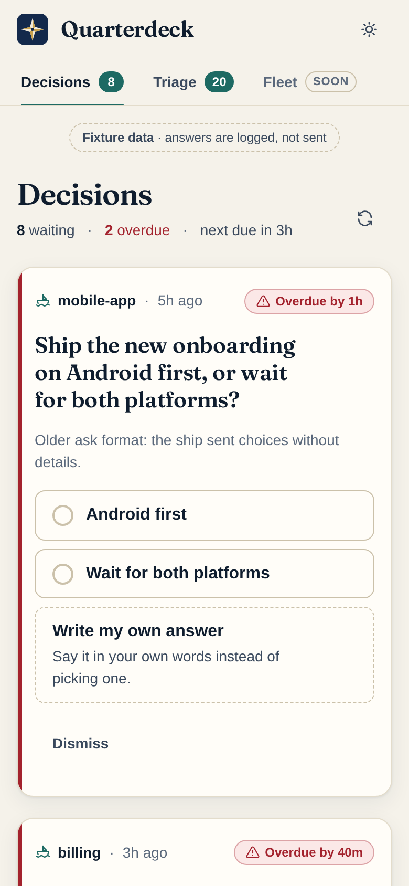
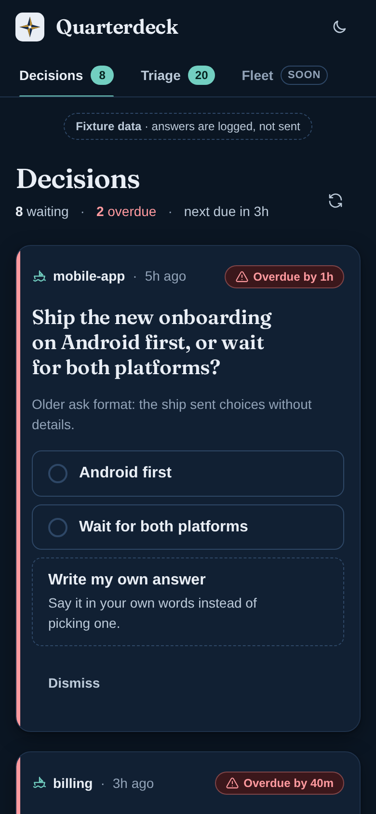
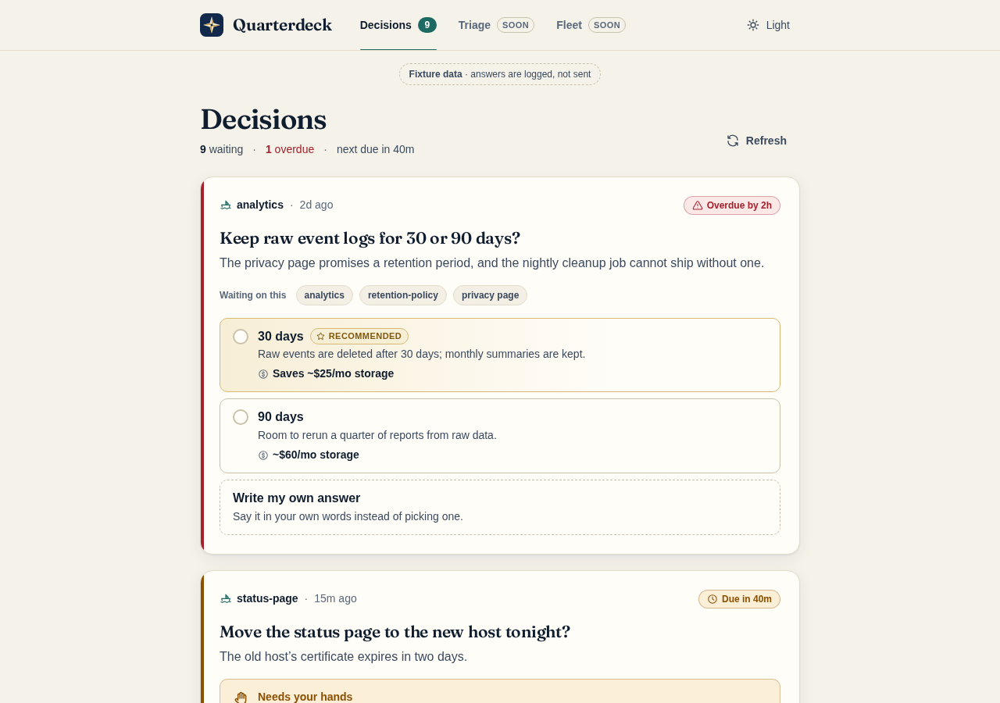

# Quarterdeck

A web portal for a [Privateer](https://github.com/kirkins/privateer) fleet: where the captain sees what every ship needs and decides.

- **Decisions**: one card per thing the captain must decide, with options, costs and the ship's recommendation.
- **Triage**: everything owed to the captain, in one list: decisions, requests, approvals and blocked items, sorted by urgency, then deadline, then age.
- **Fleet**: machines, ships and crew, with what each is doing. Read-only; refreshes every 15 s while visible.
- **Reports**: a ship's Markdown or HTML report, read in a sandboxed frame. Select a passage (or tap a paragraph on a phone) to comment; send every comment back to the ship as one reply.

Quarterdeck reads Privateer only through its JSON commands, and answers as the captain. It must never be reachable without authentication.

Status: early development. Decisions, Triage, Fleet and Reports are live. Fleet reads a provisional `fleet.snapshot` shape; see [docs/DECISIONS.md](docs/DECISIONS.md) section 13.

| Phone, light                                      | Phone, dark                                     | Desktop                                               |
| ------------------------------------------------- | ----------------------------------------------- | ----------------------------------------------------- |
|  |  |  |

## Security

> [!WARNING]
> Quarterdeck acts as the captain: anyone who can load it can answer for you. Version 0 has **no authentication**. It listens on `127.0.0.1` by default. Do not expose it beyond the local machine (LAN, VPN or public host) until a login exists; if you do, put an authenticating proxy in front and firewall the port. [docs/DEPLOY.md](docs/DEPLOY.md) is the step-by-step guide for a server.

- `HOST` changes the listen address. Leave it at loopback unless an authenticating proxy is in front, or you are deliberately deploying behind a firewalled VPN address (see the guide).
- **Startup guard.** The server refuses to start when `HOST` is not loopback **and** `QD_ALLOW_SEND=1`, until the built-in login exists (`QD_LOGIN_SECRET` is reserved for it and unlocks nothing yet). It also refuses `QD_ALLOW_SEND=1` with `QD_SOURCE=fixtures`. Refusal exits with status 78 and says why.
- **Host check.** With a non-loopback `HOST`, requests whose `Host` header is not `HOST:PORT` or the `ORIGIN` host get 403. `ORIGIN` should be set to the address the browser uses; startup warns when it is not.
- Privateer is called with `execFile` and an argv array, never through a shell.
- Answers are only logged, not sent, unless `QD_SOURCE=cli` **and** `QD_ALLOW_SEND=1`.

## Run it

Requires Node 26 and npm.

```sh
npm install
npm run dev            # http://127.0.0.1:5173, fixture data
```

Production build:

```sh
npm run build
npm start              # http://127.0.0.1:3000 (HOST and PORT to change)
```

To run it on a server, reachable only over a VPN, follow [docs/DEPLOY.md](docs/DEPLOY.md). It includes a systemd user unit template in `deploy/`.

### Configuration

All settings come from the environment (see [.env.example](.env.example)). `npm start` also reads a `.env` file if there is one.

| Variable                          | Default     | Meaning                                                                              |
| --------------------------------- | ----------- | ------------------------------------------------------------------------------------ |
| `QD_SOURCE`                       | `fixtures`  | `fixtures` reads JSON from `fixtures/`; `cli` asks a live Privateer home.            |
| `PRIVATEER_BIN`, `PRIVATEER_HOME` |             | The privateer binary and home, for `QD_SOURCE=cli`.                                  |
| `QD_ALLOW_SEND`                   | off         | Exactly `1` to really send answers from the `cli` source. Otherwise they are logged. |
| `QD_LOGIN_SECRET`                 |             | Reserved for the coming login; unlocks nothing yet.                                  |
| `QD_FIXTURES_DIR`                 | `fixtures`  | Where the fixture source reads `captain.waiting.json` and `runtime.needs.json`.      |
| `HOST`, `PORT`                    | `127.0.0.1` | Listen address. `PORT` defaults to 3000 for `npm start`, 5173 for `npm run dev`.     |
| `ORIGIN`                          |             | The browser's address, `http://<host>:<port>`. Required when `HOST` is not loopback. |

The live source runs `captain.waiting` and `runtime.needs`. `captain.waiting` is open to the captain and the captain's liaison; `runtime.needs` is an operator command. The process needs one of those rights on that home, or Privateer refuses both.

## How answering works

Each card shows the question, why it matters, who is blocked, the options (what happens, cost, and the ship's recommendation, marked but never preselected), the deadline and the asking ship. Answering is two deliberate steps: pick an option, or choose **Write my own answer** and say it in your own words (always available, whatever the ship asked for). Add a note under a chosen option if you want, then press **Send answer**. **Cancel** or Escape backs out.

The answer is a `captain.reply`, keyed by the ask's item id. Privateer finds the ask and its ship; Quarterdeck sends no `from`, `to`, `correlation` or `task_id`:

```json
{
	"id": "<item id of the ask>",
	"body": "<chosen label> — <note>",
	"payload": { "answer": { "option_id": "<id>", "text": "<note>" } }
}
```

`text` alone is always accepted: the captain can answer any decision in their own words. `free_text_ok` on a decision is only a hint that the ship especially invites one. Older asks that only carry `payload.choices` are shown as simpler cards and answered with `payload.answer.text`.

Dismissing an ask is `captain.dismiss {id, note?}`. Live answering stays off until Privateer's `captain.reply` and `captain.dismiss` land.

In fixture mode, or without `QD_ALLOW_SEND=1`, the server logs the exact `captain.reply` or `captain.dismiss` arguments and argv instead of running them, and marks the card answered in memory.

## Develop

```sh
npm run lint           # prettier + eslint
npm run check          # svelte-check
npm test               # vitest: schema, data layer, fixtures
npm run test:e2e       # Playwright smoke test (chromium) against a production build
npm run screenshots    # refresh docs/screenshots
```

Layout:

- `src/lib/decision.ts`: the decision schema, its validator, and mail → card normalisation.
- `src/lib/server/privateer.ts`: the CLI runner (`execFile`, argv only) and typed errors.
- `src/lib/server/source.ts`: `CliSource`, `FixtureSource`, and the send-or-log rule.
- `src/lib/shapes.ts`: reads the real `captain.waiting` and `runtime.needs` output into one item model.
- `src/lib/triage.ts`: triage kinds, sections, sort order and filters.
- `src/lib/fleet.ts`: the fleet map's summary, needs per ship, and machine and ship sort order.
- `src/lib/server/answer.ts`: builds the reply from the captain's choice.
- `startup-guard.js`: the startup checks (`server.js` runs them) and the Host check (`src/hooks.server.ts`).
- `src/routes/+page.server.ts`: loads cards; the `answer` form action.
- `fixtures/`: invented ships and asks covering every card variant.

Why the stack looks the way it does: [docs/DECISIONS.md](docs/DECISIONS.md).

## License

MIT
